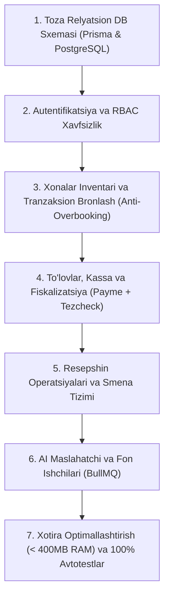

# SIHHAT.UZ — MUKAMMAL QAYTA QURISH MASTER REJASI (0 DAN PROD GAChA)

> **Hujjat maqsadi:** Ushbu reja Sihhat.uz platformasini noldan boshlab eng yuqori korporativ va xavfsizlik standartlari asosida qayta qurish uchun ishlab chiqildi.
> **Asosiy qoida:** *Avval Backend to'liq va mukammal qilib tuziladi, barcha testlardan o'tkaziladi, so'ngra uning ustiga yangi dizayndagi zamonaviy Frontend (Veb-sayt, Hamkorlar portali, Superadmin portali va Mobil APK) quriladi.*

---

## 1. LOYIHANI O'RGANISH NATIJALARI VA TUZATILADIGAN BAGLAR

Oldingi arxitekturadagi barcha tizimli zaifliklar va ularning yangi yechimlari:

### 1.1. Server RAM Crash va Jarayonlar Portlashi
- **Eski holat:** 1–2 GB RAMli arzon VPS (masalan, Hostra)da bir vaqtning o‘zida 7 ta Node/PM2 jarayoni (ikkita alohida Next.js SSR, NestJS API, bot, worker, demo servislar) ishlab, xotira to‘lib qolar va butun server qotib qolar edi.
- **Yangi yechim:**
  - API xotirasi qat'iy cheklanadi: `NODE_OPTIONS="--max-old-space-size=256"`.
  - Barcha background vazifalar (muddati o'tgan bronlarni tozalash, eslatmalar, SMS qayta urinish) bitta yengil ichki scheduler/workerga birlashtiriladi.
  - Veb-panellar og'ir Next.js SSR o'rniga yuqori tezlikdagi yengil SPA (React + Vite) yoki to'liq optimallashtirilgan Static Export tarzida ishga tushiriladi.
  - Umumiy operativ xotira sarfi **< 400 MB** bo'ladi.

### 1.2. Overbooking va Poyga Holati (Race Condition)
- **Eski holat:** Bir nechta foydalanuvchi bir vaqtda ayni bitta xonani band qilishga uringanda sanalar kesishishi xavfi bor edi.
- **Yangi yechim:**
  - PostgreSQL darajasida qat'iy pessimistik qulflash (`SELECT ... FOR UPDATE`).
  - **15 daqiqalik HOLD holati (TTL taymer):** Foydalanuvchi xonani tanlab to‘lov sahifasiga o‘tganda, xona boshqalar uchun yopiladi.
  - Agar 15 daqiqa ichida to‘lov bo‘lmasa, cron-job xonani avtomatik bo‘shatadi. To‘lov bo‘lsa `CONFIRMED` holatiga o‘tadi. 1000 ta parallel so‘rovda ham dublikat bron bo‘lmaydi.

### 1.3. SMS Shlyuzi va Avtorizatsiya Bog'liqligi
- **Eski holat:** Eskiz SMS provayderida uzilish yoki balans tugashi holatlarida butun platformaga kirish to‘xtab qolardi.
- **Yangi yechim:**
  - **Dual-channel avtorizatsiya:** Telefon raqam bilan birga **Email OTP** qo‘llab-quvvatlanadi.
  - Lokal/demo muhit uchun xavfsiz test rejimi (bypass) ta'minlanadi.

### 1.4. To'lovlar Duplikatsiyasi va Fiskalizatsiya Uzilishi
- **Eski holat:** Webhook qayta-qayta kelganda hisob-kitoblar chalkashishi yoki Tezcheck uzilib qolganda chek chiqmay qolishi xavfi bor edi.
- **Yangi yechim:**
  - **Idempotent Webhook Handler:** Har bir tranzaksiya unikal xesh va kalit bilan tekshiriladi, takroriy chaqiruvlar e'tiborga olinmaydi.
  - **Double-Entry Ledger:** Har bir tiyin buxgalteriya balansi tarzida (Debit/Credit) qayd qilinadi.
  - **Tezcheck Soliq QR:** To'lov muvaffaqiyatli bo'lishi bilan Soliq qo'mitasining rasmiy fiskal cheki va QR kodi avtomatik generatsiya qilinadi.

### 1.5. Resepshin va Kassa Nomutanosibligi
- **Eski holat:** Resepshinda naqd pul yoki terminal orqali qabul qilingan to‘lovlar smena oxirida chalkashib ketardi.
- **Yangi yechim:**
  - **Qat'iy Smena Tizimi (`Shift`):** Resepshin xodimi ishga kelganda kassa qoldig'i bilan smenani ochadi, topshirayotganda esa tushumlarni kiritib hisobot bilan yopadi.

---

## 2. YANGI SAYT VA ILOVA UI REDIZAYN REJASI

Butun platforma yagona professional tibbiy-sanatoriya dizayn tizimi (*Emerald Teal + Slate Blue + Ice White*) asosida qayta loyihalanadi.

### 2.1. Ommaviy Veb-sayt va Mobil Ilova (Mijozlar uchun)
1. **Bosh Sahifa (Smart Search & Discovery):**
   - Zamonaviy qidiruv: Viloyat, sanalar, mehmonlar soni.
   - **Tibbiy Profil filtri:** Kasallik turlari bo‘yicha tezkor tugmalar (Yurak-qon tomir, Oshqozon-ichak, Bo‘g‘im va umurtqa, Asab tizimi, Nafas yo‘llari, Endokrinologiya).
   - Eng yuqori reytingli va tavsiya etilgan sanatoriyalar slayderi.
   - Interaktiv O'zbekiston xaritasi orqali sanatoriyalarni tanlash.
2. **AI Maslahatchi (Smart Medical Advisor):**
   - Zamonaviy interaktiv chat interfeysi.
   - Foydalanuvchi shikoyatini yozadi (*"Onamning oyoqlari og'riydi, sokin joy va mineral vanna kerak"*).
   - AI faqat haqiqiy bazadan mos keladigan 2-3 ta sanatoriyaning interaktiv kartalarini narxlari va sharoitlari bilan taklif qiladi.
3. **Sanatoriya Sahifasi (Detail View):**
   - 360°/Full-HD fotogalereya, tibbiy davolash muolajalari ro‘yxati, shifokorlar tarkibi, 3 mahal parhez taomnomalari, joylashuv xaritasi va mehmonlar sharhlari.
   - Jonli narx kalkulyatori: Sanalar va xona turini tanlash bilan umumiy summa bir zumda hisoblanadi.
4. **Tezkor Checkout va Elektron Vaucher:**
   - 3 qadamli qulay to‘lov: Mehmon ma'lumotlari -> To‘lov usuli (Payme, Click, Joyida to'lash) -> Tasdiq.
   - To‘lovdan so‘ng dinamik QR-kodli elektron vaucher (Apple Wallet / Google Wallet uslubida). Resepshinda 10 soniyada skanerlab xonaga kiritiladi.

### 2.2. Hamkorlar Portali (Direktor va Resepshin yagona platformasi)
- **Yagona Kirish (`/login`):** Rolga qarab interfeys moslashadi:
  - **Resepshin uchun:**
    - **Bandlik Taqvimi (Gantt / Timeline):** Har bir xonaning kunlar bo‘yicha interaktiv bandlik lentasi.
    - **Xonalar Shaxmati (Rack View):** Xonalar holati ranglar bilan (Yashil — Bo‘sh, Qizil — Band, Sariq — Tozalanmoqda, Moviy — Kutilmoqda).
    - **Keluvchilar va Ketuvchilar (Arrivals / Departures):** 1 ta tugma bilan Check-in va Check-out qilish.
    - **Smena va Kassa:** Naqd pul va terminal tushumlari hisoboti.
  - **Direktor uchun:**
    - Oylik daromad, o‘rtacha bandlik ko‘rsatkichi (Occupancy rate), xonalar narxlari, mavsumiy tariflar va chegirmalar boshqaruvi, xodimlar ruxsatnomalari.

### 2.3. Superadmin Portali (Platforma Nazorati)
- Respublika bo‘yicha umumiy aylanma (GMV), platforma komissiyasi tushumlari.
- Yangi sanatoriyalarning anketalarini moderatsiya qilish (Tasdiqlash / Rad etish).
- Sanatoriya rahbarlariga tizimli topshiriq va ogohlantirishlar yuborish (Broadcast xabarlar).
- To‘liq xavfsizlik va audit jurnali.

---

## 3. BACKENDNI MUKAMMAL QILISHNING 7 TA BOSQICHI (FAZA 1)

Backend arxitekturasi **NestJS + PostgreSQL (Prisma) + Redis** texnologik steki asosida quyidagi qat'iy ketma-ketlikda ishlab chiqiladi:



### 1-bosqich: Toza Relyatsion Ma'lumotlar Bazasi Modeli (Prisma ORM)
- Noto'g'ri va tushunarsiz JSON maydonlardan voz kechib, to'liq normallashgan SQL relyatsiyalari:
  - `User`: ID, telefon, email, parol xeshi, rol (`SUPERADMIN`, `DIRECTOR`, `RECEPTION`, `GUEST`), status.
  - `Sanatorium`: Kod, nom, viloyat, manzil, koordinata, komissiya foizi, reyting, holat (`PENDING`, `ACTIVE`, `SUSPENDED`).
  - `SanatoriumProfile`: Tavsif, tibbiy profillar (massiv), qulayliklar (massiv), ovqatlanish turlari, fotosuratlar galereyasi.
  - `RoomType`: Nomi (Standart, Lyuks, Kottej), sig'imi, baza narxi, tavsifi, qulayliklari.
  - `Room`: Jismoniy xona raqami (101, 102), qavat, holati (`AVAILABLE`, `OCCUPIED`, `CLEANING`, `MAINTENANCE`).
  - `Booking`: Unikal raqam (`SH-XXXXX`), sanatoriya ID, xona ID, xona turi ID, mehmon ma'lumotlari, kelish/ketish sanalari, kechalar soni, jami summa, holdExpiresAt (15 min), QR vaucher tokeni, statuslar.
  - `Payment`: Tranzaksiya kodi, summa, usul (`PAYME`, `CLICK`, `CASH`, `TERMINAL`), status, Tezcheck soliq ma'lumotlari.
  - `Shift`: Xodim ID, ochilgan vaqti, yopilgan vaqti, kassa boshlang'ich va yakuniy naqd puli, farq, izoh.
  - `AuditLog`: Amalni bajargan shaxs, amal turi, maqsadli obyekt, vaqt.

### 2-bosqich: Autentifikatsiya, Ruxsatlar (RBAC) va Xavfsizlik
- Mobil mijozlar uchun: Telefon raqamga SMS OTP + Email OTP zaxira kanali.
- Xodimlar uchun: Email/Login + Parol + Superadmin uchun 2FA (MFA).
- Tokenlar: Qisqa muddatli Access Token (15 min) + Xavfsiz Refresh Token (30 kun, aylanuvchi).
- Xavfsizlik qatlami: Argon2 parollar xeshlash, Rate Limiting (Throttler), Helmet sarlavhalari, CSRF himoyasi.

### 3-bosqich: Xonalar Inventari va Bronlash Dvigateli
- Bo'sh xonani aniqlash va tranzaksion band qilish:
  ```sql
  SELECT r.id FROM rooms r
  WHERE r.sanatorium_id = :sanatoriumId 
    AND r.room_type_id = :roomTypeId
    AND r.status = 'AVAILABLE'
    AND r.id NOT IN (
        SELECT b.room_id FROM bookings b
        WHERE b.booking_status IN ('HOLD', 'CONFIRMED', 'CHECKED_IN')
          AND b.check_in < :checkOut 
          AND b.check_out > :checkIn
    )
  LIMIT 1 FOR UPDATE;
  ```
- 15 daqiqalik qulflash (`HOLD`) va muddati o'tganda xonani bo'shatuvchi avtomatlashtirilgan cron-job.

### 4-bosqich: To'lovlar, Kassa va Tezcheck Fiskalizatsiyasi
- Payme va Click merchant integratsiyasi: to'lov xavfsiz havolasi va idempotent webhook tekshiruvi.
- Tezcheck API: To'lov tasdiqlanishi bilan Soliq qo'mitasiga fiskal chek yuborish va QR kodni vaucherga biriktirish.
- Joyida to'lash: Resepshin naqd yoki terminal to'lovini qabul qilganda kassa kvitansiyasi chiqarish.

### 5-bosqich: Resepshin Operatsiyalari va Smena Moduli
- Smena ochish (`Shift Open`) va smenani topshirish (`Shift Close`).
- Check-in: Mehmon vaucherini tekshirish va xona holatini `OCCUPIED` qilish.
- Check-out: Chiqishni rasmiylashtirish va xona holatini `CLEANING` ga o'tkazish.
- Walk-in booking: Resepshinga to'g'ridan-to'g'ri kelgan mehmonlar uchun qo'lda tezkor bron yaratish.

### 6-bosqich: AI Maslahatchi va Fon Ishchilari
- Google Gemini 2.5 Flash bilan RAG tibbiy maslahatchi: Bemor shikoyatlariga asosan faqat bazadagi faol sanatoriyalarni taklif qilish.
- Fon xizmati: Muddati o'tgan bronlarni tozalash, kelishdan 24 soat oldin mehmonlarga eslatma yuborish.

### 7-bosqich: Xotira Optimallashtirish va Avtotestlar
- Butun backend servisining RAM sarfini < 256MB darajasida ushlash.
- Swagger OpenAPI (`/docs`) orqali barcha 40+ endpointlarni hujjatlashtirish.
- Unit va integratsion testlar bilan barcha hisob-kitoblar va qulflarni 100% tekshirish.

---

## 4. AMALGA OSHIRISH KETMA-KETLIGI

| Tartib | Bosqich | Natija |
|---|---|---|
| **1** | **Backend Ma'lumotlar Bazasi va Prisma** | Yangi relyatsion modellar, migratsiyalar, seed skripti |
| **2** | **Backend Auth & RBAC Moduli** | OTP, JWT, Rollar va Ruxsatlar himoyasi |
| **3** | **Backend Bronlash va Inventar Dvigateli** | FOR UPDATE qulfi, 15 min Hold, Overbooking yo'qotilishi |
| **4** | **Backend To'lov va Fiskalizatsiya** | Payme, Click, Tezcheck Soliq QR integratsiyasi |
| **5** | **Backend Resepshin & Smena Moduli** | Check-in/out, Smena ochish/yopish, Walk-in |
| **6** | **Backend AI va Fon Servislari** | Gemini maslahatchi va fon tozalovchilari |
| **7** | **Backend Testlar va Optimallashtirish** | To'liq avtotestlar, xotira sarfi < 256MB, Swagger |
| **8** | **Frontend: Hamkorlar Portali (Web)** | Resepshin taqvimi, xonalar shaxmati, direktor paneli |
| **9** | **Frontend: Superadmin Portali (Web)** | Moderatsiya, Respublika aylanmasi, Broadcast |
| **10** | **Frontend: Mobil Ilova (Android APK)** | Yangi dizayndagi mijoz ilovasi, AI chat, QR vaucher |
